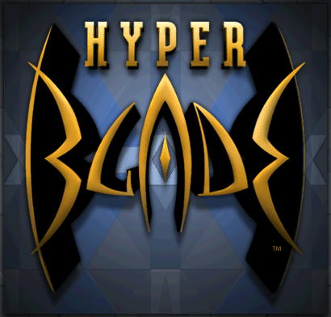
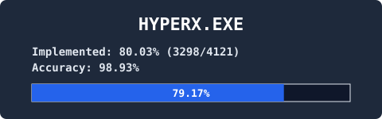

# hyperblade-decomp

<p align="center">
  
</p>

<p align="center">
  <a href="https://github.com/zach2good/hyperblade-decomp/actions/workflows/ci.yml"></a>
</p>

A byte-matching decompilation of `HYPERX.EXE` v1.0.0.1, from the 1996 game HyperBlade, built with
Visual C++ 6.0 SP3 and scored per function by [reccmp](https://github.com/isledecomp/reccmp). Its
method and tooling follow the [LEGO Island decompilation](https://github.com/isledecomp/isle).

This repository has a basic bring-up shim that gets the game running in its simplest form, for
testing; see [Running the game](#running-the-game). To play on a modern system, use
[hyperblade-20XX](https://github.com/zach2good/hyperblade-20XX), the modernised and portable
version of this project.

You need your own copy of the game. The logo and screenshot are shown for identification. Not
affiliated with Activision or WizBang! Software Productions.

<p align="center">
  
</p>

## Status

<p align="center">
  
</p>

**2,791 of 3,054 game functions match exactly: 473,691 bytes, 75.34 per cent of game code.**

| Measure | Value |
| --- | --- |
| Game functions, below `0x004a0000` | 3,054 |
| **Matching exactly** | **2,791** |
| Effective but not exact | 29 |
| Exact bytes of game code | 473,691 of 628,779 |
| Rows in `symbols/functions.csv`, the C runtime included | 4,121 |

## Requirements

- Windows. Run the commands below from Git Bash, which also provides `patch`.
- CMake 3.21 or later, for the presets.
- Python 3.12 or later.
- clang-format 22 if you contribute: `pip install clang-format==22.1.8`, the version CI runs.
- Ghidra, optional, for reading functions nobody has written yet. See
  [docs/GHIDRA.md](docs/GHIDRA.md).
- Your own copy of HyperBlade, with `HYPERX.EXE` at v1.0.0.1.

### Checking your copy

Only v1.0.0.1 matches:

| File | Size | MD5 | SHA256 |
| --- | --- | --- | --- |
| `HYPERX.EXE` | 860,160 | `420c5c49ee2ae5ae9adf329bb2ee5702` | `514bcec6805f27136bed6e4de8796e75d99f224a94e3d7098a4477b029ea24cd` |

Check yours with:

```sh
certutil -hashfile HYPERX.EXE SHA256
```

A different hash usually means v1.0.0.0, the unpatched release. Install the 1.0.0.1 patch.

## Setup

1. Install the Python requirements, then patch reccmp:

   ```sh
   pip install -r tools/requirements.txt
   patch -p1 -d "$(python -c 'import os, reccmp; print(os.path.dirname(os.path.dirname(reccmp.__file__)))')" < tools/reccmp_call_table.patch
   ```

2. Clone [zach2good/vc6-sp3-toolchain](https://github.com/zach2good/vc6-sp3-toolchain) and set
   `VC6_ROOT` to it.

3. Copy `reccmp-user.example.yml` to `reccmp-user.yml` and point it at your `HYPERX.EXE`.
   `python tools/reference.py` prints the path it found, or says what is missing.

## Build and score

```sh
cmake --preset vc6sp3
cmake --build --preset vc6sp3
cmake --build build --target verify
python -m reccmp.tools.asmcmp --target HYPERX --verbose 0xADDRESS --no-color
```

`verify` scores every function and runs the structural checks. The last line shows one
function's diff. reccmp's `Dropped duplicate address` errors are expected. Don't run
`build/out/HYPERX.exe`, which changes the display resolution.

Without a copy of the game, configure with `-DHYPERX_COMPILE_ONLY=ON`. That compiles every source
but links no image and runs no check.

## Running the game

The bring-up build adds a windowed mode and other fixes under `#ifdef HYPERX_BRINGUP`, and draws
with the game's software renderer. Copy the disc's `DATA` folder into `build/out` as `Data`, then:

```sh
cmake --preset bringup
cmake --build --preset bringup
python tools/check_match.py    # play one match
```

To play by hand, run `build-bringup/out/hyperx_bringup_soft.exe`. `src/app/bringup.cpp` lists the
`HB_` environment switches.

## Extracting the game's data

```sh
python tools/extract_rc.py          # menu, dialogs, strings, version and icon, as an .rc script
python tools/extract_mdm1.py --png  # every MDM1-packed bitmap in build/out/Data, as BMP and PNG
python tools/plan_dump.py           # the AI plans, printed as pseudo-source
```

The first two write under `build/extracted`.

## FAQ

### What does the percentage count?

Bytes of game code below `0x004a0000` in functions that match exactly. Effective and partial matches
count nothing. Some exact functions are libjpeg and C runtime code that matches because we link the
same library. `python tools/progress.py` reports the share this project wrote by hand.

### Why Visual C++ 6.0 SP3?

The original's Rich header names that toolchain, and only the same compiler and linker can emit the
same bytes. `tools/richcheck.py` compares the two.

### Why match bytes instead of writing a port?

A byte match proves the source is the program that shipped. Fixes and modernisation belong in
[hyperblade-20XX](https://github.com/zach2good/hyperblade-20XX).

### Can I use AI tools?

Yes, but review what they write closely. The project began as hand work and soon moved to AI tools
under close human review. Point your tools at [AGENTS.md](AGENTS.md). The rules in
[CONTRIBUTING.md](CONTRIBUTING.md) apply to every change, whoever wrote it.

## Project structure

| Path | What's in it |
| --- | --- |
| `src/` | The reconstructed source, one folder per subsystem. [src/README.md](src/README.md) lists them. |
| `symbols/` | Facts about the original that the build and the checkers read. |
| `tools/` | The scorer's helpers, the checkers and the extractors. [tools/README.md](tools/README.md) lists them. |
| `docs/` | How the matching works, and what we've learned about the game. Start at [docs/README.md](docs/README.md). |
| `progress/` | The status card and the history of the figures. |
| `third_party/` | IJG libjpeg 6a, linked as the original linked it. |
| `cmake/` | The VC6 SP3 toolchain file and the resource build. |

## Contributing

Start with [CONTRIBUTING.md](CONTRIBUTING.md).

## Legal

This project is for preservation, research and interoperability. It holds no original binary,
game data, disassembly listing or Ghidra database. Don't attach any of these to an issue or a
pull request, and don't ask for a copy of the game.

## Licence

LGPL-3.0-only for this project's own work. To compile to the same bytes, the source reproduces the
original's string literals, constants and data tables; [NOTICE](NOTICE) says what the licence
covers. HyperBlade belongs to its rights holders and Visual C++ 6.0 to Microsoft. This software is
based in part on the work of the Independent JPEG Group.
