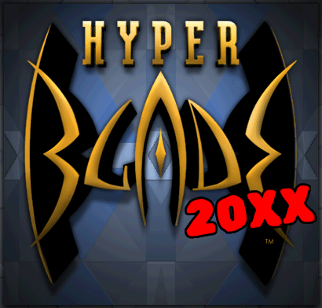
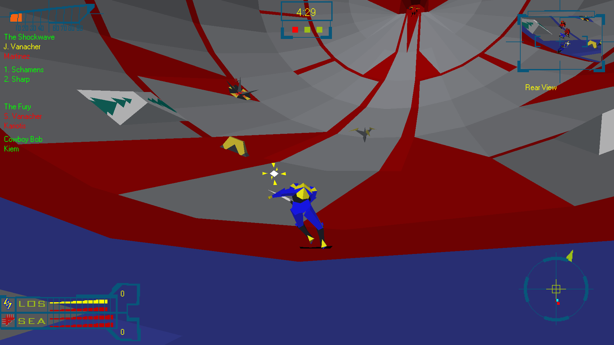

# hyperblade-20XX

<p align="center">
  
</p>

<p align="center">
  <a href="https://github.com/zach2good/hyperblade-20XX/actions/workflows/ci.yml"></a>
</p>

HyperBlade (1996), rebuilt and improved for modern systems. Built on top of
[hyperblade-decomp](https://github.com/zach2good/hyperblade-decomp).

You need your own copy of the game. Not affiliated with Activision or WizBang! Software Productions.

<p align="center">
  
</p>

## Features

- Drops into your existing HyperBlade install
- Supports all releases (original disc release (v1.0.0.0), Windows 2000 patch (v1.0.0.1), both with or without the Voodoo2 launcher (HB3DFxV2.exe))
- Built for 64-bit Windows with a modern C++23 toolchain
- In-game debug menu on F2
- Runtime toggles for:
  - Original software renderer
  - New hardware renderer
  - Textured models
  - Gouraud shading/Phong shading
  - Rok emits light
  - Realtime shadows
- Widescreen support
- HUD and menu scaling
- Xbox, PlayStation and Switch controller support
- Music tracks can play from local rips, rather than the CD
- Skippable intro splash screens
- Experimental uncapped frame rate, with the game still simulated at 30 Hz
- Various bug and crash fixes

## TODO

- Update menus to support controller button re-binding
- Play-test the Linux build, which builds and passes its tests but has not been run on a desktop
- Mac and browser builds via Emscripten
- Net and local multiplayer
- Bot-only matches
- Free-fly spectator mode
- AI plan bug and balance fixes ([docs/plan_bugs.md](docs/plan_bugs.md))
- The original RC, debug and plan menus in the debug menu

## Install

Download `hyperblade_20XX.zip` for Windows, or `hyperblade_20XX-linux.tar.gz` for Linux, from
[Releases](https://github.com/zach2good/hyperblade-20XX/releases) and unpack it into your HyperBlade
folder, beside `HYPERX.EXE`. Then run `hyperblade_20XX`. Keep `20XX_data.pak` beside it: it holds
our fonts and controller icons.

The first run reads the game's text out of `HYPERX.EXE` into `hyperblade_20XX_strings.txt`, and
later runs load that file.

To play the music without the CD, rip the audio tracks to `Data/Music/Track02.flac`,
`Track03.flac` etc. FLAC, MP3 and WAV are all supported.

## Build

### Windows

You need Visual Studio 2022 or later with the C++ x64 tools, CMake 3.21 or later, and Ninja. From
an x64 Developer Command Prompt:

```sh
cmake --preset msvc-x64
cmake --build build
cmake --install build --prefix package
```

### Linux

[docker/linux.Dockerfile](docker/linux.Dockerfile) holds the toolchain and SDL's build dependencies.
It builds, tests and installs into `build-linux/package`:

```sh
docker build -t hyperblade-linux -f docker/linux.Dockerfile docker
docker run --rm -v "$PWD:/src:ro" -v "$PWD/.cpm-cache-linux:/cpm" -v "$PWD/build-linux:/build" hyperblade-linux
```

The build needs nothing from the game.

## Tools

These need Python 3.12 or later. Some read your `HYPERX.EXE`, so copy `hyperx-user.example.yml` to
`hyperx-user.yml` and point it there.

```sh
python tools/extract_rc.py          # menu, dialogs, strings, version and icon, as an .rc script
python tools/extract_mdm1.py --png  # every MDM1-packed bitmap in Data, as BMP and PNG
python tools/plan_dump.py           # the AI plans, printed as pseudo-source
python tools/make_icon.py           # redraws the Rok icon into res/
```

[docs/](docs/README.md) holds what we know about the game: the class hierarchy, the other files on
the disc, and the bugs in the shipped AI plans.

## Legal

This project is for preservation, research and interoperability. It holds no original binary,
game data or disassembly. Don't attach any of these to an issue or a pull request, and don't ask
for a copy of the game.

LGPL-3.0-only for this project's own work. [NOTICE](NOTICE) says what the licence covers.
HyperBlade belongs to its rights holders.
