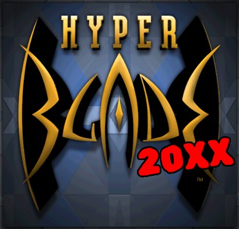
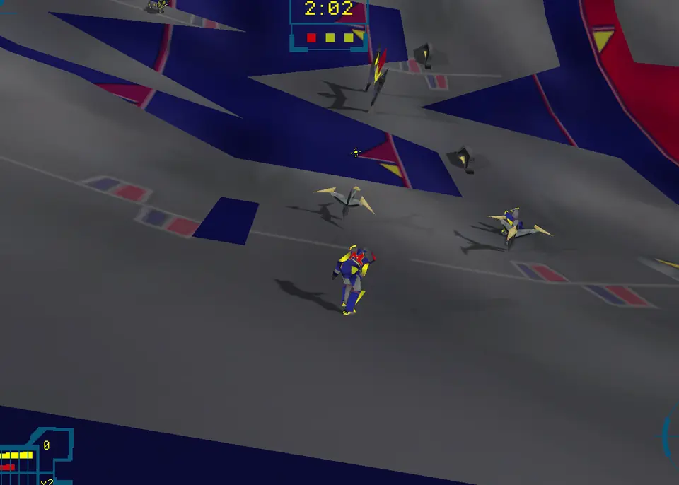

# hyperblade-20XX

<p align="center">
  
  
</p>

<p align="center">
  <a href="https://github.com/zach2good/hyperblade-20XX/actions/workflows/ci.yml"></a>
  <a href="https://github.com/zach2good/hyperblade-20XX/releases/latest"></a>
  <a href="COPYING.LESSER"></a>
  
  
  <a href="https://github.com/zach2good/hyperblade-decomp"></a>
</p>

HyperBlade (1996), rebuilt and improved for modern systems. Built on top of
[hyperblade-decomp](https://github.com/zach2good/hyperblade-decomp).

You need your own copy of the game. Not affiliated with Activision or WizBang! Software Productions.

## Features

- Drops into any HyperBlade install: v1.0.0.0, v1.0.0.1, with or without the Voodoo2 launcher
- 64-bit Windows and Linux builds, and a browser build that loads your own HyperBlade folder
- New hardware renderer with realtime soft shadows, smooth shading and a light on the rok, or the
  original software renderer
- Widescreen, HUD and menu scaling, and an uncapped frame rate over the 30 Hz simulation
- Xbox, PlayStation and Switch controllers
- Music from local rips instead of the CD
- Fixed AI plans, so AI carriers pass and shoot ([docs/plan_bugs.md](docs/plan_bugs.md))
- Goalie control: G or left shoulder sends your goalie after the rok and back
- Bot spectator mode: `-b`, or Tab for the side view
- Cut content finished: One on One, local 2 Player Mode, instant replay (R), time outs (T) and a
  scouting report on pause, with the match's stats and both rosters' health
- Lifetime stats for dromers and teams, saved beside the executable
- Stats the original never recorded or got wrong: passes, interceptions, checks given, drags won,
  hang time, rail time, assists and one-timers ([docs/sim_results.md](docs/sim_results.md#match-stats))
- Debug menu on F2, with every cheat and a switch for each new feature
- The original's menu bar and dialogs, rebuilt, plus a model viewer, sound player and image browser
- Skippable intro, and many bug and crash fixes

## TODO

- Controller button re-binding in the game's own menus. The F2 Bindings window does it for now
- Play-test the Linux build on a desktop. It builds, passes its tests and plays simulated matches
- Play-test on a Mac. CI builds it with AppleClang on macOS 15 and passes its tests, but the hardware
  renderer can't load its shaders there until they're built in Metal's format
- Play-test the browser build from [docker/emscripten.Dockerfile](docker/emscripten.Dockerfile): pick a real
  folder, play a match, reload
- Net multiplayer, and split screen for local 2 Player Mode
- Turn the balance proposals on by default once people have played them. They're the
  "Balanced teams" switch in the F2 menu's Plans tab, off for now
- The original RC, debug and plan menus in the debug menu

## Install

Download `hyperblade_20XX.zip` for Windows, or `hyperblade_20XX-linux.tar.gz` for Linux, from
[Releases](https://github.com/zach2good/hyperblade-20XX/releases) and unpack it into your HyperBlade
folder, beside `HYPERX.EXE`. Then run `hyperblade_20XX`. Keep `20XX_data.pak` beside it: it holds
our fonts and controller icons.

The first run reads the game's text out of `HYPERX.EXE` into `hyperblade_20XX_strings.txt`, and
later runs load that file.

To play the music without the CD, rip the audio tracks to `Data/Music/Track02.flac`,
`Track03.flac` and so on, as FLAC, MP3 or WAV. On Linux the rips are the only music, as the
port reads the CD drive on Windows alone.

## Simulating matches

`-sim` plays AI-only matches with no window or sound, about 2,000 times faster than real time on
one core, and writes every player's match stats to `sim_results.csv` beside the executable:

```sh
hyperblade_20XX -sim LOSAN SEATTLE 100 1 fixed
```

The arguments, in order:

- The home team and the away team: a file name, a team name or an index. A team can play itself,
  and an unknown team lists them all.
- The number of matches.
- The first seed. Each match adds one, and the same seed replays the same matches, byte for byte,
  on Windows, Linux and in the browser.
- `fixed` or `shipped` plans.
- Optionally `balanced`, to play BLAM! Nemesis and The Sturmnacht with the ratings the balance
  proposals in [docs/sim_results.md](docs/sim_results.md#balance-proposal-blam-nemesis) give them.
- Optionally `arena=TEAM`, to play in that team's drome instead of the home team's.
- Optionally a file ending in `.csv`, to write instead of `sim_results.csv`.

The match settings in `booie.ini`, such as difficulty and period length, still apply, and a
simulation never writes that file. Each row is one player in one match: the plans, whether the
balance proposals were on, the difficulty and period length, the player's health at the end (100 is
unhurt), the score and the game's own match stats.

With `gauntlet` in place of the away team, the count is seasons: the home team plays the
Gauntlet's bracket each season until it loses or wins, and one line per season says how far it
got, and whether a loss or a draw ended it, with the score. Each match loads both teams afresh, so injuries do not carry from match to match as they may
in a played Gauntlet.

Errors print instead of opening a dialog. A fatal one ends the run with exit code 3 and keeps the
matches already written.

## Build

The build needs nothing from the game. Each preset in [CMakePresets.json](CMakePresets.json)
configures, builds and tests, and the `package` target writes the drop-in archive to
`packages/` in its build folder.

### Windows

You need Visual Studio 2022 or later with the C++ x64 tools, CMake 3.25 or later, and Ninja. From
an x64 Developer Command Prompt:

```sh
cmake --preset msvc-x64
cmake --build --preset msvc-x64
ctest --preset msvc-x64
cmake --build --preset msvc-x64 --target package
```

### Linux

[docker/linux.Dockerfile](docker/linux.Dockerfile) holds GCC 14, Clang 20, clang-tidy 20 and SDL's
build dependencies. It builds, tests and packages with the preset `PRESET` names, `linux-gcc` by
default:

```sh
docker build -t hyperblade-linux -f docker/linux.Dockerfile docker
docker run --rm -e PRESET=linux-gcc -v "$PWD:/src:ro" -v "$PWD/.cpm-cache-linux:/cpm" -v "$PWD/build-linux:/build" hyperblade-linux
```

On a Linux machine with those tools, the `linux-gcc` and `linux-clang` presets work as the Windows
one does. GCC and Clang build with `-Wall -Werror`, and MSVC with `/W4 /WX`.

### Browser

[docker/emscripten.Dockerfile](docker/emscripten.Dockerfile) builds a wasm64 page into `build-wasm/out`
and runs the unit checks under Node:

```sh
docker build -t hyperblade-emscripten -f docker/emscripten.Dockerfile docker
docker run --rm -v "$PWD:/src:ro" -v "$PWD/.cpm-cache-linux:/cpm" -v "$PWD/build-wasm:/build" hyperblade-emscripten
python -m http.server --directory build-wasm/out
```

Open `hyperblade_20XX.html` in a desktop browser. The page asks for your HyperBlade folder once
and keeps a copy in the browser, with your saves and career. The files never leave your machine.
Command-line arguments go in the address, as `?args=-s -sim JAMCA LEEDS 2 7 fixed`; a simulation
prints to the browser console.

### Tests

The `unit` checks need nothing. `gpu` draws through SDL's GPU API and reports itself skipped with
no device. The `data` checks read the game's own files and run only when `HYPERX_GAME_DATA` names
your HyperBlade folder, which also links its folders in beside the built image:

```sh
cmake --preset msvc-x64 -DHYPERX_GAME_DATA=C:/Games/HyperBlade
ctest --preset msvc-x64 -L data
```

[.clang-tidy](.clang-tidy) holds the static checks. The presets export compile commands, so run
`clang-tidy -p build` on a file. CI runs it on the port's own files, the tests and the sources
without a `FUNCTION: HYPERX` marker, and fails on any finding. The decomp's files keep the
original's style and raise some of the checks by design.

## Tools

These need Python 3.12 or later. Some read your `HYPERX.EXE`, so copy `hyperx-user.example.yml` to
`hyperx-user.yml` and point it there.

```sh
python tools/extract_rc.py          # menu, dialogs, strings, version and icon, as an .rc script
python tools/extract_mdm1.py --png  # every MDM1-packed bitmap in Data, as BMP and PNG
python tools/plan_dump.py           # the AI plans, printed as pseudo-source
python tools/make_icon.py           # redraws the Rok icon into res/
```

[docs/](docs/README.md) holds what we know about the game and the port: the class hierarchy, the
other files on the disc, the bugs in the shipped AI plans, the hardware renderer and simulated
matches.

## Legal

This project is for preservation, research and interoperability. It holds no original binary,
game data or disassembly. Don't attach any of these to an issue or a pull request, and don't ask
for a copy of the game.

LGPL-3.0-only for this project's own work. [NOTICE](NOTICE) says what the licence covers.
HyperBlade belongs to its rights holders.

`20XX_data.pak` carries two CC0 sets: the [Pixel Operator](res/fonts/PixelOperator-LICENSE.txt)
fonts and Kenney's [Input Prompts](res/prompts/License.txt).
